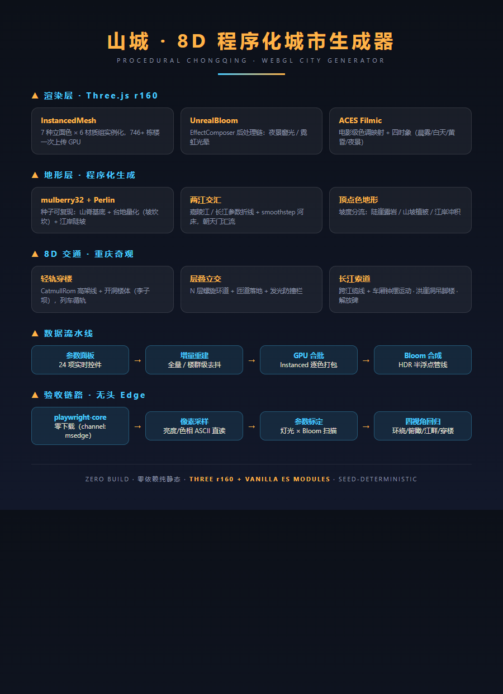

# 山城 · 8D 程序化城市生成器 🌆

对标 OpenAI Showcase「Procedural City Generator」的产品形态（全屏画布 + 右侧浮动参数面板、参数实时生效、视角预设、随机种子），把城市换成了**重庆 8D 魔幻山城**。



## 重庆视觉特征

- **两江交汇**：嘉陵江 + 长江在朝天门汇合，河床切入地形，江岸陡坡
- **依山而建**：山脊基底 + 台地量化（坡坎坎），楼底嵌入山体不悬空
- **轻轨穿楼**：高架轨道线横穿开洞楼体（李子坝），列车循环运行
- **层叠立交**：多层螺旋环道 + 匝道落地，发光防撞栏读出层次
- **洪崖洞**：崖壁吊脚楼群层叠爬升，暖金灯带（可开关）
- **解放碑**：八角碑体 + 金色顶灯 + 环形广场（可开关）
- **长江索道**：跨江缆线 + 钟摆车厢（可开关）

## 参数面板（24 项）

| 分组 | 参数 |
|------|------|
| 种子 | 数字输入 / 🎲 随机 / ⟳ 重新生成 |
| 地形·世界 | 山地起伏、河道宽度、台地高差、公园绿地 |
| 城市·布局 | 城市规模、建筑密度、街区尺寸、街道形态（放射/棋盘/顺山） |
| 天际线 | 楼宇高度、高度离散、霓虹灯光、洪崖洞、解放碑 |
| 交通·8D | 立交层数、轻轨速度、长江索道、车流动画 |
| 氛围 | 晨雾 / 白天 / 黄昏 / 夜景、雾气浓度、自动旋转 |
| 灯光 | 曝光、太阳高度、环境补光 |
| 视角 | 环绕 / 俯瞰 / 江畔 / 穿楼 |

顶部按钮：**📷 截图**（下载当前画面 PNG）。

## 运行

零构建、零 npm 依赖（Three.js 已本地化在 `vendor/`）：

```bash
cd chongqing-citygen
py -m http.server 8778     # 任意静态服务器均可
# 打开 http://127.0.0.1:8778/
```

## 技术要点

- **确定性生成**：mulberry32 种子随机 + Perlin fbm 地形，同一种子同一座城
- **合批**：楼群按立面颜色 7 组 InstancedMesh，一次 draw 上传
- **增量重建**：地形/路网参数 → 全量重建；楼群参数 → 仅重建楼群（120ms 去抖，拖动跟手）
- **健壮性**：每帧自愈尺寸检测（面板开合/标签切换防 0×0）、后台标签低频渲染兜底

## 验收

`verify/` 内置无头验收链（playwright-core + Edge channel，零浏览器下载）：

```bash
cd verify && node shot.js     # 四视角 + 参数响应 + 截图
node views.js                 # 三视角 ASCII 亮度图
```

指标：夜景 746 栋 / 11.9 万三角面 / 换种子 802 栋 / 密度拉满 1069 栋，均实时生效。
